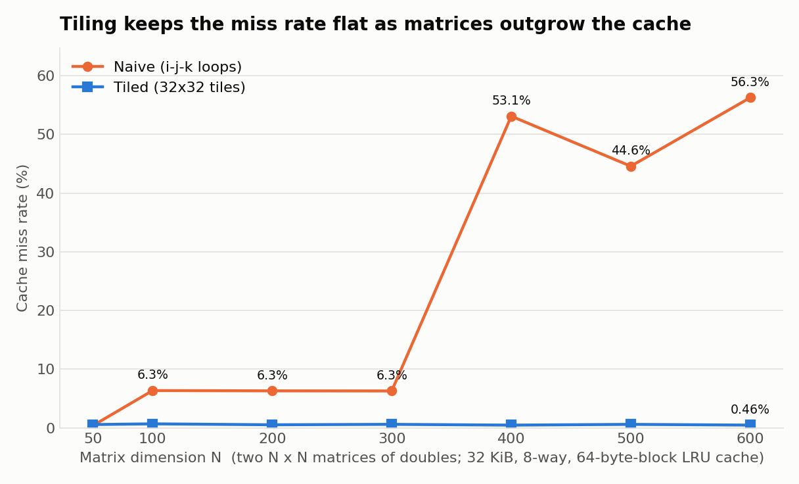
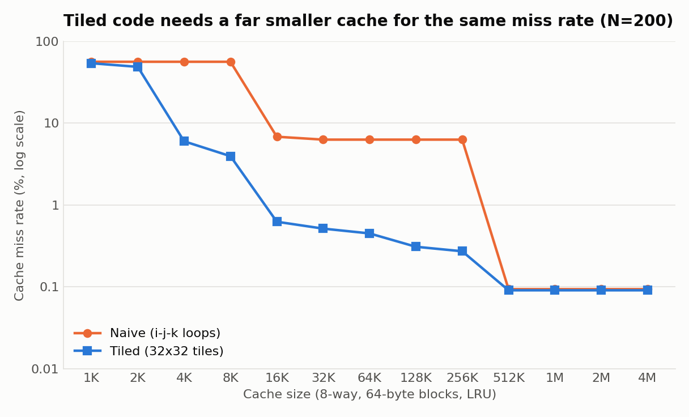
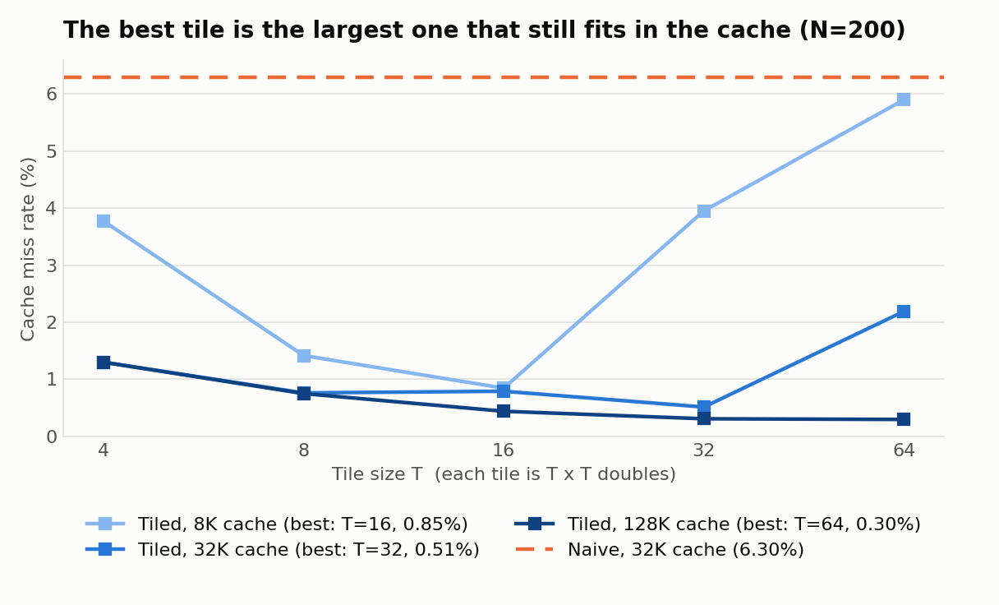
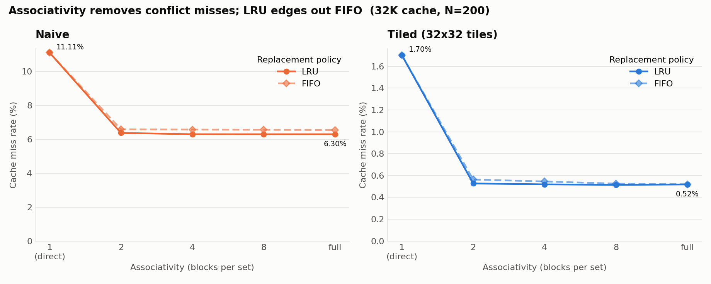

# CacheSim

A trace-driven CPU cache simulator in C++17, used to measure how much **loop tiling** helps matrix multiplication, the operation at the heart of AI workloads.

**Headline result:** for a 600 × 600 matrix multiply on a simulated 32 KiB L1 cache, tiling the loops cut the cache miss rate from **56.29% to 0.46%**, which is **119× fewer cache misses** (243.4 million down to 2.0 million), without changing the arithmetic performed.



## What it is

| Part | What it does |
|---|---|
| `cachesim` | Simulates a cache and reports accesses, hits, misses, miss rate and write-backs. Cache size, block size, associativity (direct-mapped to fully associative) and replacement policy (LRU or FIFO) are command-line flags. Writes use write-back with write-allocate. |
| `tracegen` | Generates the memory-address trace of an N × N matrix multiplication, either naive (plain `i-j-k` loops) or tiled with a configurable tile size. |
| `tests/` | 31 unit tests built from cases small enough to verify by hand, plus 5 end-to-end checks of the command-line programs. |
| `scripts/run_experiments.py` | Sweeps cache size, associativity, policy, tile size and matrix size; saves CSVs and draws the graphs in `results/`. |

No third-party C++ dependencies: the project needs only a C++17 compiler and CMake.

## Why it matters for GPU and AI workloads

Matrix multiplication (GEMM) is where neural networks spend most of their time: fully connected layers, attention, and convolutions are all computed as matrix products. These kernels are usually limited by **memory**, not arithmetic: a processor can multiply far faster than it can fetch operands that are not already in a nearby cache.

Tiling (also called cache blocking) is the standard fix. It reorders the loops so the computation works on small sub-matrices that fit in fast memory, and reuses them many times before moving on. The same idea appears throughout the AI stack:

- BLAS libraries that sit underneath deep-learning frameworks block their GEMM kernels to fit each cache level.
- GPU kernels tile work to fit shared memory and on-chip caches, since trips to global memory dominate cost.
- ML compilers such as TVM, Halide and MLIR treat loop tiling as a core scheduling transformation.

This project builds the measurement tool from scratch and uses it to quantify the effect, which is the kind of reasoning performance engineers apply when tuning kernels for a specific memory hierarchy.

## Results

All numbers below come from `results/summary.txt`, produced by 822 simulations covering 19.2 billion simulated memory accesses. Matrices hold 8-byte doubles; blocks are 64 bytes.

### 1. Tiling keeps the miss rate flat as matrices grow

On a 32 KiB, 8-way, LRU cache (a typical L1 data cache):

| N | Naive miss rate | Tiled miss rate (best tile) | Fewer misses |
|---:|---:|---:|---:|
| 100 | 6.35% | 0.67% (T=32) | 9.1× |
| 200 | 6.30% | 0.51% (T=32) | 11.9× |
| 300 | 6.28% | 0.59% (T=32) | 10.3× |
| 400 | 53.11% | 0.45% (T=32) | 113.4× |
| 500 | 44.59% | 0.59% (T=32) | 73.7× |
| 600 | 56.29% | 0.46% (T=32) | 119.3× |

The naive version falls off a cliff near N = 400: its inner loop walks down a column of `B`, touching one new cache block per element, and beyond that size the cache can no longer hold a whole column between one pass and the next. The tiled version never notices, because its working set is three 32 × 32 tiles (24 KiB) regardless of N.

### 2. Tiled code needs a far smaller cache



For N = 200, the naive version needs a 512 KiB cache to get below a 1% miss rate. The tiled version gets there with 16 KiB, a cache 32× smaller.

### 3. The best tile is the largest one that fits



Tiles that are too small waste the cache; tiles that are too large overflow it. The best tile size tracks the cache size: T=16 for 8 KiB, T=32 for 32 KiB, T=64 for 128 KiB. In each case that is the largest tested tile for which three tiles (one each from `A`, `B` and `C`) fit in the cache.

### 4. Associativity and replacement policy



For N = 200 on a 32 KiB cache:

- Going from direct-mapped to 2-way removes most conflict misses: naive drops from 11.11% to 6.38%, tiled from 1.70% to 0.53%. Beyond 2 ways the gains are small.
- LRU is slightly better than FIFO. Across all 390 configurations in the sweep, LRU had fewer misses in 208, FIFO in 16, and they tied in 166.

### A trade-off worth knowing

Tiling is not free. The tiled loops revisit each result element once per tile along `k`, so results are written to memory more often. At N = 200 the tiled version (T=32) caused 15,132 write-backs against 4,997 for naive, even while taking 11.9× fewer misses.

## Build and run

Requirements: CMake 3.16+, a C++17 compiler, and (for the graphs only) Python 3.8+ with matplotlib.

```bash
git clone https://github.com/sne-web/cachesim-gemm.git
cd cachesim-gemm

cmake -S . -B build
cmake --build build
ctest --test-dir build --output-on-failure
```

On Windows with MinGW, add `-G "MinGW Makefiles"` to the first `cmake` command. With Visual Studio, add `--config Release` to the build command and `-C Release` to `ctest`.

### Simulate a workload

```bash
# Naive 200 x 200 multiply on a 32 KiB, 8-way, LRU cache
./build/cachesim --size 32K --block 64 --assoc 8 --policy lru --workload naive --n 200

# The same multiply, tiled with 32 x 32 tiles
./build/cachesim --size 32K --block 64 --assoc 8 --policy lru --workload tiled --n 200 --tile 32
```

```text
Cache        : 32768 bytes, 64-byte blocks, 8-way, 64 sets, LRU, write-back + write-allocate
Input        : tiled matrix multiply, N=200, tile=32
Accesses     : 16560000 (16280000 reads, 280000 writes)
Hits         : 16474843
Misses       : 85157 (85157 read, 0 write)
Miss rate    : 0.5142%
Evictions    : 84645
Write-backs  : 15132 (+32 dirty blocks still cached at the end)
```

### Work with trace files

```bash
# Write a trace to a file, then simulate it
./build/tracegen --algo tiled --n 64 --tile 16 --out matmul.trace
./build/cachesim --size 8K --assoc 1 --trace matmul.trace

# Or pipe it straight in
./build/tracegen --algo naive --n 64 | ./build/cachesim --size 8K --assoc full --policy fifo --trace -
```

A trace is plain text, one access per line: `R 0x10000000` for a read, `W 0x10002000` for a write. Any program's trace in that format can be simulated.

| `cachesim` flag | Meaning | Default |
|---|---|---|
| `--size` | Total cache size (`32K`, `1M`, ...) | `32K` |
| `--block` | Block size in bytes, a power of two | `64` |
| `--assoc` | Blocks per set: `1` = direct-mapped, `full` = fully associative | `8` |
| `--policy` | `lru` or `fifo` | `lru` |
| `--trace FILE` | Simulate a trace file (`-` for standard input) | |
| `--workload naive\|tiled` | Generate the matrix-multiply trace in memory | |
| `--n`, `--tile` | Matrix dimension and tile size for `--workload` | `64`, `16` |
| `--csv` | Machine-readable output | |

### Reproduce the experiments

```bash
pip install -r requirements.txt
python scripts/run_experiments.py          # full sweep, a few minutes
python scripts/run_experiments.py --quick  # small smoke test
```

This rewrites the CSVs, graphs and `summary.txt` in `results/`. The simulator is deterministic, so the numbers reproduce exactly.

## How it works

An address is split into three fields:

```text
| tag | set index | block offset |
```

The set index picks a set, and the tag is compared against the blocks stored in that set. A match is a hit. Otherwise the block is loaded, evicting the least recently used block (LRU) or the oldest arrival (FIFO) if the set is full. An evicted block that was written to counts as a write-back.

The trace generators do no arithmetic. They walk the same loops as a real multiply and emit the address of every element touched, assuming the running sum is held in a register as an optimising compiler would arrange.

## Scope and limitations

- This measures **cache misses, not run time**. Fewer misses usually means faster code, but the size of the speed-up depends on the machine.
- One cache level is modelled, with no hardware prefetcher, no TLB and no multi-core effects. A real prefetcher would hide some of the naive version's sequential misses.
- Both versions use the same `i-j-k` loop order, so the comparison isolates tiling. Reordering the loops is a separate optimisation that is not studied here.
- The tiled trace has slightly more accesses than the naive one (it re-reads and re-writes results once per tile), so the tables report the ratio of absolute miss counts alongside miss rates.

## Project layout

```text
include/cachesim/   cache.hpp, matmul.hpp, trace.hpp, options.hpp
src/                cache.cpp, trace.cpp, options.cpp, cachesim_main.cpp, tracegen_main.cpp
tests/              unit tests, a hand-worked trace, CLI checks
scripts/            run_experiments.py
results/            CSV data, graphs, summary.txt
```
